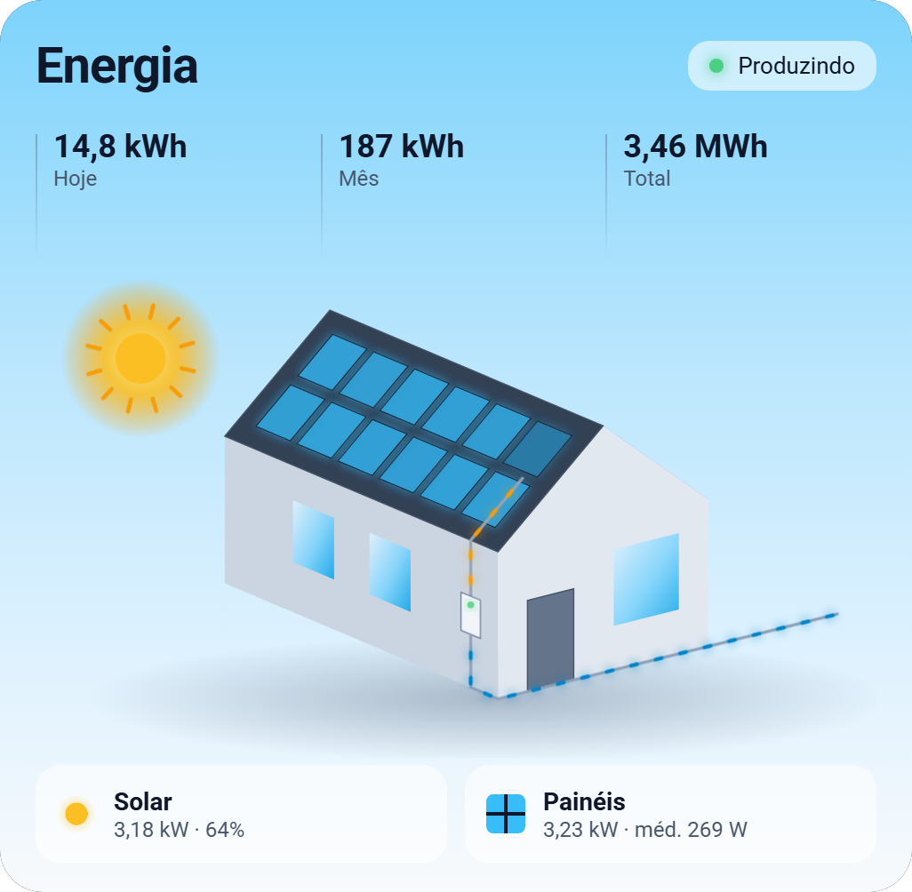
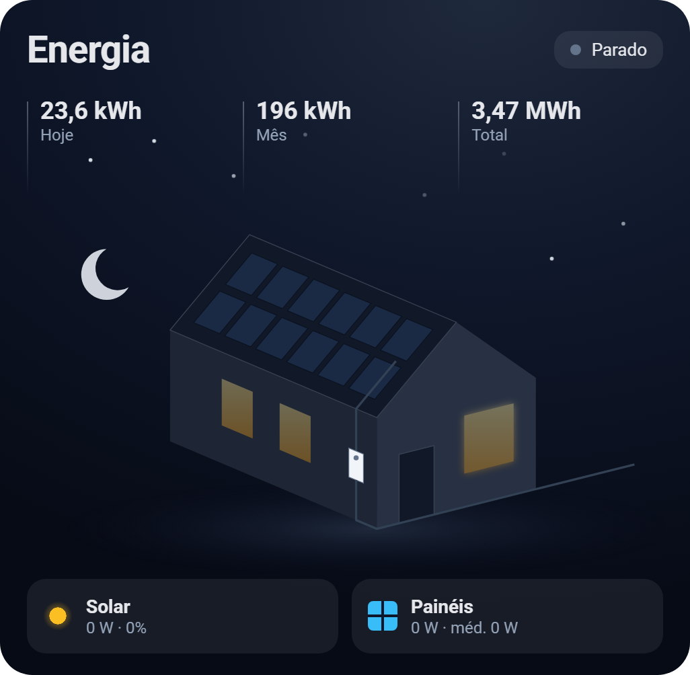

# SolarEdge One para Home Assistant

[](https://hacs.xyz/docs/faq/custom_repositories)
[](LICENSE)

<p align="center">
  
  
</p>
<p align="center"><sub>Card incluso na integração, de dia e à noite (dados fictícios).</sub></p>

Integração customizada que traz para o Home Assistant os dados do portal **SolarEdge ONE** (`monitoring.solaredge.com/one`), **com detalhe por otimizador**. Basta entrar com o mesmo e-mail e senha do portal: não precisa de chave de API nem de acesso de instalador.

- Potência atual do sistema e estado da produção
- Telemetria de cada otimizador: potência, tensão do módulo, tensão de saída, corrente e temperatura máxima do dia
- Energia de hoje, do mês e total, do site, de cada inversor e de cada otimizador, pronta para o painel de **Energia**
- Status do inversor e dos otimizadores, conectividade do site e alertas
- Card animado incluso, com uma casa e um painel no telhado para cada otimizador

> [!WARNING]
> Esta integração **não é oficial** e não tem nenhuma ligação com a SolarEdge. Ela usa a API interna do dashboard web, que não é documentada e pode mudar sem aviso. Use por sua conta e risco.

## Requisitos

- Home Assistant **2025.2** ou mais recente
- Uma conta em [monitoring.solaredge.com](https://monitoring.solaredge.com) com acesso ao site
- A conta **não pode ter verificação em duas etapas (MFA)** ativada

## Instalação

### Via HACS (recomendado)

1. No HACS, abra o menu **⋮ → Repositórios personalizados**.
2. Adicione `https://github.com/maiochi/ha-solaredge-one` com a categoria **Integração**.
3. Procure **SolarEdge One (Portal Web)**, instale e reinicie o Home Assistant.

### Manual

Copie a pasta `custom_components/solaredge_one` para dentro de `config/custom_components/` e reinicie o Home Assistant.

## Configuração

Vá em **Configurações → Dispositivos e serviços → Adicionar integração → SolarEdge One** e preencha:

| Campo | Descrição |
|---|---|
| **ID do site** | O número que aparece depois de `siteId=` na URL do dashboard. Exemplo: `https://monitoring.solaredge.com/one#/residential/dashboard?siteId=1234567` |
| **E-mail** e **Senha** | Os mesmos usados para entrar no portal |
| **Cookie** *(opcional)* | Só é necessário se a Cloudflare bloquear o Home Assistant. Veja em [Solução de problemas](#solução-de-problemas) |
| **User-Agent** *(opcional)* | Pode ficar com o valor padrão, a menos que você informe um cookie |

A integração renova o acesso sozinha e refaz o login quando necessário. O Home Assistant só pede **Reautenticar** se a senha mudar.

### Intervalos de atualização

Ajuste em **Configurar**, na página da integração:

| Grupo | Padrão | Mínimo |
|---|---|---|
| Potência atual | 120 s | 60 s |
| Otimizadores, energia e status | 900 s | 300 s |

Os otimizadores só enviam dados ao portal a cada cerca de 15 minutos, então consultar mais rápido do que isso não traz informação nova. Se o portal limitar as requisições, a integração dobra o intervalo (até 1 h) e volta ao normal assim que uma consulta der certo.

## Entidades

| Dispositivo | Sensores |
|---|---|
| **Site** | Potência solar, produção (`producing` / `idle` / `not_communicating`), potência total dos otimizadores, energia de hoje, do mês e total, conectividade, alertas e última atualização |
| **Inversor** | Status e energia de hoje, do mês e total |
| **Otimizador** | Potência, tensão do módulo, tensão de saída, corrente, temperatura máxima de hoje, energia de hoje, do mês e total, status e última medição |

Leituras de otimizador com mais de 1 hora (por exemplo, à noite) são consideradas antigas: potência e corrente passam a 0, e o último valor recebido fica no atributo `last_reported`.

O portal só informa a **temperatura máxima do dia** de cada otimizador. Não existe leitura de temperatura instantânea.

### Painel de Energia

Em **Configurações → Painéis → Energia → Produção solar**, escolha o sensor **Energia total** do site ou do inversor.

## Card animado

A integração já registra o card `custom:solaredge-energy-card`. Não é preciso cadastrar o recurso à mão.

```yaml
type: custom:solaredge-energy-card
```

O card mostra:

- uma casa isométrica com um painel no telhado para cada otimizador, colorido pela potência dele (painéis com sombra ou defeito aparecem mais escuros);
- o fluxo de energia animado do telhado até o inversor, mais rápido quanto maior a produção;
- sol durante o dia e lua com estrelas à noite, de acordo com `sun.sun`;
- potência solar, média dos painéis e energia de hoje, do mês e total.

Clicar em um painel, número ou indicador abre o histórico do sensor correspondente.

As entidades são encontradas automaticamente. Para escolher manualmente:

| Opção | Descrição |
|---|---|
| `title` | Título do card |
| `power`, `state` | Sensores de potência solar e de produção |
| `energy_today`, `energy_month`, `energy_total` | Sensores de energia |
| `array_power` | Potência total dos otimizadores |
| `optimizers` | Lista de sensores de potência dos otimizadores |
| `max_power` | Potência máxima do sistema, em W (padrão: a do inversor) |
| `panel_max_power` | Potência máxima de um painel, em W (padrão: 440) |

## Como funciona

**Login.** O portal autentica pelo AWS Cognito usando o protocolo **SRP**, o mesmo fluxo do site. Nele, a senha **nunca é enviada**: o servidor recebe só uma prova de que o cliente a conhece. A implementação está em [`cognito.py`](custom_components/solaredge_one/cognito.py), em Python puro, sem dependências. A senha e o refresh token ficam guardados na configuração local do Home Assistant (`.storage`), como em outras integrações de nuvem.

**Dados.** Todas as chamadas vão para `https://monitoring.solaredge.com`:

| Dado | Endpoint |
|---|---|
| Potência atual | `GET /services/dashboard/live-power/sites/{siteId}` |
| Fluxo de potência e estado | `GET /services/dashboard/power-flow/v2/sites/{siteId}` |
| Equipamentos e status | `GET /services/layout/logical/generic/v2/site/{siteId}?include-optimizers=true` |
| Telemetria dos otimizadores | `POST /services/layout/information/optimizers` (lista de seriais no corpo) |
| Energia por inversor e otimizador | `GET /services/layout/energy/site/{siteId}/by-inverter` |
| Início da produção | `GET /services/layout/information/site/{siteId}` |
| Conectividade | `GET /services/dashboard/site-details/{siteId}/communication` |
| Alertas | `GET /services/dashboard/alerts/sites/{siteId}` |

Cada ciclo faz poucas requisições, não importa quantos painéis existam: a telemetria de todos os otimizadores vem em uma única chamada. Os totais do mês e da vida útil são calculados uma vez por dia (do início do período até ontem) e somados à energia de hoje a cada ciclo.

As rotas ficam em [`const.py`](custom_components/solaredge_one/const.py) e os parsers, em [`api.py`](custom_components/solaredge_one/api.py).

## Solução de problemas

| Erro | O que fazer |
|---|---|
| **E-mail ou senha incorretos** | Confira se você consegue entrar em monitoring.solaredge.com com os mesmos dados |
| **A conta exige MFA** | A verificação em duas etapas não é suportada. Use uma conta sem MFA com acesso ao site |
| **Bloqueado pela Cloudflare** | No navegador logado no portal, abra o DevTools (F12) → Network, copie o cabeçalho `cookie` de uma requisição a `monitoring.solaredge.com` e cole no campo **Cookie**. Informe também o **User-Agent** desse navegador, porque o cookie `cf_clearance` fica atrelado a ele |
| **Nenhum equipamento encontrado** | Confira o ID do site |

Para ver logs detalhados, adicione ao `configuration.yaml`:

```yaml
logger:
  logs:
    custom_components.solaredge_one: debug
```

## Desenvolvimento

A pasta `tools/` tem scripts que usam só a biblioteca padrão do Python:

- **`test_auth.py`** testa o login e a leitura da API sem o Home Assistant. Ele só faz leituras e não imprime tokens. A senha é pedida no terminal.
  ```bash
  python -I tools/test_auth.py <siteId> --user voce@email.com
  ```
- **`har_analyzer.py`** separa os endpoints de um HAR capturado no dashboard, útil para remapear a API se ela mudar.
  ```bash
  python -I tools/har_analyzer.py arquivo.har --dump amostras/
  ```

> [!CAUTION]
> Um HAR do dashboard contém tokens de acesso válidos e dados pessoais. Não publique nem faça commit desse arquivo, e apague-o depois de usar.

Contribuições são bem-vindas. Se algo parar de funcionar, [abra uma issue](https://github.com/maiochi/ha-solaredge-one/issues) com os logs em modo `debug`, removendo antes e-mail, tokens e seriais.

## Licença

Distribuído sob a [licença MIT](LICENSE). SolarEdge é marca registrada da SolarEdge Technologies Ltd. Este projeto não tem ligação com a empresa.
